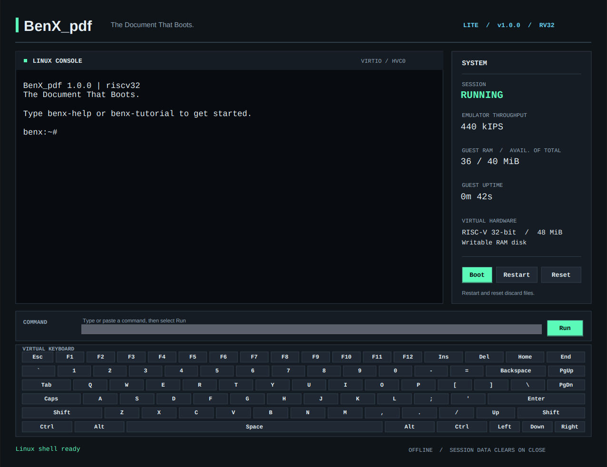
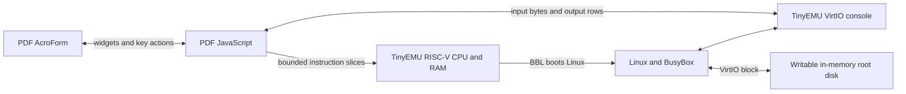

# BenX_pdf

**The Document That Boots.**

BenX_pdf boots a real RISC-V Linux guest inside a standalone PDF. The built-in Chromium viewer executes TinyEMU compiled to asm.js. Linux runs a BusyBox shell and writes to a guest disk backed by memory. The PDF contains the emulator, bootloader, kernel, and filesystem.

[Download the PDF editions](https://github.com/NateshKannaR/BenX_pdf/tree/artifacts/v1.0.0) · [Build guide](docs/build.md) · [Architecture](docs/architecture.md) · [Benchmark results](benchmarks/README.md) · [Validation](docs/validation.md)



## Run the workstation

1. Download an edition and open it directly in desktop Chromium’s built-in PDF viewer.
2. Wait for **RUNNING** and the `benx:~#` prompt. Keep the tab in the foreground during boot.
3. Type `benx-info` into **COMMAND** and select **Run**. The on-page keyboard sends individual terminal keys for vi, shell history, and Ctrl+C.
4. Run `benx-tutorial` to practice with files, scripts, and diagnostics. Use **Restart** for a fresh running VM or **Reset** to return to the idle screen.

Closing, restarting, or resetting discards guest writes. Boot restores the original embedded root disk. Saving a copy through the viewer does not save the guest disk. Viewer JavaScript must be enabled.

| Edition | Architecture | Guest RAM | Tools |
| --- | --- | ---: | --- |
| Lite | RV32 | 48 MiB | BusyBox, vi, shell, AWK, filesystem utilities and tutorial |
| Developer | RV32 | 64 MiB | Lite tools plus Lua 5.4.8, Lua bytecode compilation, c4 and C/Lua examples |
| Advanced | RV64 | 96 MiB | 64-bit Buildroot guest, BusyBox and a system-monitoring script |

Chromium 156 was used for automated browser tests. Desktop Chrome and Edge are candidates because they ship Chromium’s native PDF viewer, but this project has no separate test result for either product. Firefox PDF.js, macOS Preview, Acrobat, mobile viewers, and managed browsers that disable PDF JavaScript are unsupported. Workstation output uses a monochrome ASCII VT100 subset.

## How Linux runs



The original LinuxPDF rasterized its framebuffer into ASCII across 200 fields. BenX reads the Linux serial console directly and compares each of its 24 rows before updating the viewer. The runtime implements a compact VT100 subset, a queued console input path, and bounded CPU slices. The memory and uptime fields use actual data sampled from the guest’s `/proc`. See [architecture notes](docs/architecture.md).

## Build and test

```bash
./build.sh lite
./build.sh developer
./build.sh advanced
make test
```

Builds use x86-64 Linux. The pinned container requires no privileged mounts, guest `chroot`, or host package installation. See [Docker and Arch Linux instructions](docs/build.md). In a successful [GitHub Actions build](https://github.com/NateshKannaR/BenX_pdf/actions/workflows/build.yml), download the **BenX-pdf-editions** artifact for all three PDFs and their SHA-256 sidecars.

## Performance

The comparison used the original LinuxPDF RV32 code and Chromium 156 on one AMD EPYC cloud instance.

| Metric | LinuxPDF RV32 | BenX Lite |
| --- | ---: | ---: |
| PDF file size | 6,284,428 bytes | 3,830,292 bytes |
| Time to shell | 58.3 s | 40.5 s |
| Median displayed throughput during boot | 1,051 kIPS | 1,650 kIPS |
| Median virtual Enter to visible change | 459 ms | 486 ms |

The throughput counters use different accounting. Rendering and input latency were variable, and this run does not show a latency improvement. [Methods and raw samples](benchmarks/README.md)

## Limits and licensing

The guest’s historical Linux kernel and userspace are for an offline demonstration. The virtual hardware exposes a console and disk. There is no NIC, guest-to-host file sharing, browser DOM integration, package installation from the internet, or persistence. Developer’s c4 emits code for its own bytecode VM. Native ELF builds need a separate RISC-V toolchain.

BenX code is GPL-3.0-or-later. LinuxPDF is by ading2210. TinyEMU is by Fabrice Bellard and carries its MIT notice. Guest and third-party components keep their respective licenses. [Credits and source references](CREDITS.md)
